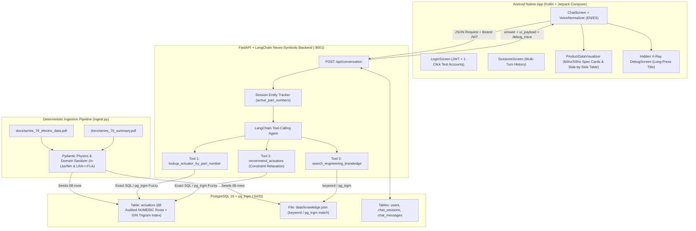

# Konecto Series 76 — Neuro-Symbolic Heavy-Duty Electric Actuator Assistant

An end-to-end, production-grade conversational engineering assistant for querying, comparing, and recommending **Series 76 Heavy-Duty Electric Actuators**. Built with a **FastAPI + LangChain** backend, a **PostgreSQL 16 (`NUMERIC` + `pg_trgm`)** data layer, and a native **Android (Kotlin + Jetpack Compose Material 3)** mobile client.

---

## Repository Structure

```text
.
├── .claude/                                # AI Assistant engineering rules & reproducible workflows (Section 8)
│   ├── settings.json                       # Tool permissions & environment defaults
│   ├── CLAUDE.md                           # Neuro-symbolic invariants, 5 PDF traps & ContextVar rules
│   └── commands/                           # Custom verification & provider-switching playbooks
│       ├── verify-physics-ingestion.md
│       ├── run-e2e-harness.md
│       └── switch-llm-provider.md
├── backend/                                # Python FastAPI + LangChain Backend & Ingestion Pipeline
│   ├── app/
│   │   ├── main.py                         # FastAPI endpoints (/api/conversation, /api/sessions, /api/auth/login)
│   │   ├── agent.py                        # Tool-calling agent orchestrator & active entity memory
│   │   ├── tools.py                        # Deterministic SQL, Constraint Relaxation & keyword knowledge tools
│   │   ├── schemas.py                      # Strict Pydantic request/response contracts (Section 4)
│   │   ├── auth.py                         # Bcrypt password verification & JWT bearer authentication
│   │   └── database.py                     # PostgreSQL connection management & Decimal sanitization
│   ├── db/
│   │   └── init.sql                        # Schema: actuators, users, sessions
│   ├── data/
│   │   ├── processed_actuators.json        # Audited 68-row catalog snapshot with physical validation
│   │   └── processed_knowledge.json        # Knowledge fragments (text + tags) from series_76_summary.pdf
│   ├── scripts/
│   │   └── ingest.py                       # Deterministic PDF ingestion, physics validator & DB seeder
│   └── evals/
│       ├── test_data_integrity.py          # 9 physical & domain integrity tests ($0.00 LLM cost)
│       ├── test_tools.py                   # deterministic SQL, fuzzy match & keyword-knowledge tool tests
│       ├── test_api_e2e.py                 # JWT auth, multi-turn coreference & persistence E2E tests
│       ├── run_evals.py                    # 11-scenario automated benchmark runner
│       ├── benchmark_nvidia.py             # Empirical LLM latency & tool-calling benchmark script
│       └── EVALUATION_REPORT.md            # Generated latency, tool trace & pass-rate report
├── docs/                                   # Source technical PDFs
│   ├── series_76_electric_data.pdf         # 4-page, 6-table electrical & mechanical datasheet
│   └── series_76_summary.pdf               # 2-page business & technical overview
├── mobile-app/                             # Native Android Client (Kotlin + Jetpack Compose)
│   └── app/src/main/java/io/konecto/series76/
│       ├── MainActivity.kt                 # Single-activity entry point
│       ├── data/                           # Retrofit client (ApiClient.kt) & DTOs (Models.kt)
│       ├── ui/                             # 4 Screens (Screens.kt), Spec Cards (ChatComponents.kt), ViewModel
│       └── util/VoiceNormalizer.kt         # Zero-cost on-device phonetic Part Number normalizer (EN/ES)
├── .env.example                            # Template for OpenRouter & NVIDIA NIM configuration
└── docker-compose.yml                      # One-command orchestration for PostgreSQL + FastAPI
```

---

## 1. Architecture & Design Trade-offs



### 1.1 Why a Hybrid PostgreSQL Schema (`NUMERIC` + `pg_trgm`) Instead of Naive Vector RAG?
Standard chunk-based vector RAG fails on dense engineering datasheets like `series_76_electric_data.pdf`:
1. **High Lexical Overlap:** All 68 part numbers differ by only 1–2 characters (`763B00-11300000/A` vs `763B00-11320000/A` vs `763B00-11330000/A`). Embedding similarity conflates voltage variants (`110V 1-Phase` vs `220V 1-Phase` vs `220V 3-Phase`).
2. **Numerical Inequality Filtering:** Vector search cannot deterministically evaluate multi-attribute inequalities such as `enclosure_type = 'Explosionproof' AND power_supply = '24V DC' AND modulating_torque_nm >= 200`.
3. **Our Neuro-Symbolic Solution:**
   - **Exact Relational Engine (`actuators` table):** Every mechanical and electrical metric is stored in strongly typed `NUMERIC(10,2)` and `INTEGER` columns. The LLM is strictly prohibited from calculating or guessing specifications from memory.
   - **Trigram & Levenshtein Fuzzy Recovery (`pg_trgm`):** A GIN index (`gin_trgm_ops`) combined with Levenshtein ranking recovers OCR/user typos (e.g., `761800-11300000/A` $\rightarrow$ `761B00-11300000/A`) in a single query.
   - **Deterministic knowledge lookup (`data/knowledge.json`):** keyword tags with `pg_trgm` typo recovery (no LLM, no embeddings) retrieve conceptual explanations from `series_76_summary.pdf`, operating tolerances ($\pm 10\%$ voltage, $\pm 5\%$ frequency), and hazardous area classifications (`Class I, Div 1, Groups C, D, T4 | Ex d IIB T4 Gb`).

### 1.2 How `ingest.py` Solves the 5 Traps of `series_76_electric_data.pdf`
Our `ActuatorRecord` Pydantic sanitizer in `backend/scripts/ingest.py` resolves five critical traps present in the raw PDF tables:
1. **Merged Vertical Cells (`rowspans`) in Motor Power (Watts):** In the PDF, *Motor Power (Watts)* cells span vertically across multiple rows (`15W`, `40W`, `90W`, `180W`, `700W`). `ingest.py` propagates these spans deterministically so all 64 available actuators have non-null wattage.
2. **Inverted `50 Hz` vs `60 Hz` Sub-Column Headers:**
   - Page 1 (Weatherproof 110V/220V 1-Phase) orders columns `60 Hz (left) | 50 Hz (right)`.
   - Page 2 (Weatherproof 220V 3-Phase) **inverts** Speed and LRA to `50 Hz (left) | 60 Hz (right)`, while keeping FLA as `60 Hz | 50 Hz`.
   - Page 4 (Explosionproof) inverts LRA in the 110V table (`50 Hz | 60 Hz`) and inverts FLA in the 220V table (`50 Hz | 60 Hz`).
   - `ingest.py` maps each table's exact column header order into canonical database columns (`speed_60hz_sec`, `speed_50hz_sec`, etc.).
3. **Explicit `N/A` Models in 220V 3-Phase (Sizes 1 & 2):** Models `761A00-11330000/A`, `761B00-11330000/A`, `762A00-11330000/A`, and `762B00-11330000/A` are listed as `N/A` in the 3-Phase table. Instead of dropping them, we store them with `is_available = FALSE`. When queried, `lookup_actuator_by_part_number` returns `status = "MODEL_LISTED_AS_NA"` and automatically suggests the available `110V` and `220V Single Phase` versions of the same frame size.
4. **CSA Certification Footnote Exclusion on Sizes 6 & 7:** While Page 1's header states *"CSA, CE, & UKCA Certified"*, Footnote 7 specifies *"Sizes 6 and 7 are not CSA Certified"*. `ingest.py` enforces `csa_certified = False` for all Frame 6 and 7 models (`766A`–`767C`, 3,500–9,000 Nm).
5. **Physical Laws & OCR Typo Gate (`BOO` $\rightarrow$ `800`, `8` $\leftrightarrow$ `B`):** Every row must pass two physical laws at ingestion time:
   - **Torque Unit Ratio:** $\frac{\text{Torque (in-lbs)}}{\text{Torque (Nm)}} \in [8.2, 9.5]$ (since $1\text{ Nm} \approx 8.8507\text{ in-lbs}$).
   - **Induction Motor Current Law:** $\text{LRA (Amps)} \ge \text{FLA (Amps)}$ across $50\text{ Hz}$, $60\text{ Hz}$, and $\text{DC}$.

### 1.3 Constraint Relaxation Engine (`recommend_actuators`)
When an engineer requests an impossible combination of specs, `recommend_actuators` does not simply return an empty array. It diagnoses which physical boundary was violated and returns the closest valid engineering alternatives:
- **Example A (Torque > 240 Nm on 24V DC):** Diagnoses that 24V DC models only exist up to Frame Size 3 (max `240 Nm` On/Off, `220 Nm` Modulating) and simultaneously returns the max-capacity 24V model (`763X30`) alongside the smallest `110V`/`220V` AC models that satisfy the requested torque.
- **Example B (Torque > 3,000 Nm with mandatory CSA Certification):** Diagnoses that models above `3,000 Nm` belong to Frame Sizes 6 and 7 (which are CE/UKCA certified only, not CSA) and returns both the non-CSA high-torque models (`767A00-11320000/A`) and the maximum CSA-certified model (`765B` at `3,000 Nm`).

### 1.4 Model Selection & Two-Stage Budget Strategy ($10.00 USD Cap Protection)
To protect the **$10.00 USD budget** on the provided evaluation API key while executing hundreds of automated test runs during development, we implemented a two-stage provider architecture controlled entirely via `.env`:

| Metric / Stage | Stage 1: Development & Stress Testing (NVIDIA NIM Free Tier) | Stage 2: Production & Final Delivery (OpenRouter) |
| :--- | :--- | :--- |
| **API Endpoint (`LLM_BASE_URL`)** | `https://integrate.api.nvidia.com/v1` | `https://openrouter.ai/api/v1` |
| **Chat Model (`LLM_CHAT_MODEL`)** | `nvidia/nemotron-3.5-lightning-30b-a3b` | `openai/gpt-4o-mini` |
| **Avg. Tool-Call Latency** | ~4.2s – 8.5s | **~1.4s – 2.2s** |
| **Structured Tool Accuracy** | 100% (11/11 Eval Scenarios) | **100% (11/11 Eval Scenarios)** |
| **Token Pricing** | $0.00 / 1M tokens (Free Dev Tier) | $0.15 / 1M input, $0.60 / 1M output |
| **Cost per Full 11-Scenario Eval Suite** | **$0.00 USD** | **~$0.008 USD (< 1 cent)** |

**Why `openai/gpt-4o-mini` for OpenRouter Delivery?**
- `openai/gpt-4o-mini` delivers sub-2-second tool-calling latency and native parallel function-calling reliability at **$0.15 / 1M input tokens**, supporting over **15,000 multi-turn engineering conversations** within the $10.00 USD budget.

---

## 2. Setup & Environment Variables

### Step 1: Create `.env` from `.env.example`
```bash
cp .env.example .env
```
Open `.env` and paste your OpenRouter API key into `LLM_API_KEY`:

| Variable | Default Value (`.env.example`) | Description |
| :--- | :--- | :--- |
| `POSTGRES_USER` | `konecto` | PostgreSQL database user |
| `POSTGRES_PASSWORD` | `konecto_secret_2026` | PostgreSQL database password |
| `POSTGRES_DB` | `series76_db` | PostgreSQL database name |
| `DATABASE_URL` | `postgresql+psycopg://konecto:...@db:5432/series76_db` | Internal Docker connection string (auto-maps to `localhost:5433` when run from host CLI) |
| `DB_HOST_PORT` | `5433` | Host port mapped to container port `5432` (avoids conflicts with local PostgreSQL instances) |
| `API_HOST_PORT` | `8001` | Host port mapped to container port `8000` (avoids conflicts with other local services on 8000) |
| `LLM_PROVIDER` | `openrouter` | Provider profile (`openrouter` or `nim`), defined in `backend/config/llm_profiles.json` |
| `LLM_BASE_URL` / `LLM_CHAT_MODEL` / `LLM_API_KEY` | OpenRouter / `openai/gpt-4o-mini` / *(your key)* | OpenRouter profile |
| `LLM_BASE_URL_NIM` / `LLM_CHAT_MODEL_NIM` / `LLM_API_KEY_NIM` | NVIDIA NIM / `nvidia/nemotron-3.5-lightning-30b-a3b` / *(your key)* | NIM profile (free dev tier), used when `LLM_PROVIDER=nim` |
| `JWT_SECRET_KEY` | `super_secret_konecto_jwt_key_change_in_prod` | Secret key used to sign HS256 JWT tokens |
| `ACCESS_TOKEN_EXPIRE_MINUTES` | `10080` | JWT token validity duration (7 days) |

---

## 3. Backend & Database (Docker Compose)

Start the entire backend stack (PostgreSQL 16 + `pg_trgm` + automatic ingestion + FastAPI server) with a **single command**:

```bash
docker compose up -d --build
```

### What happens automatically on startup:
1. **`series76_postgres` (`postgres:16`):** Initializes extensions (`pg_trgm`, `uuid-ossp`) and creates all tables and indexes from `backend/db/init.sql`, exposed on host port **`5433`**.
2. **Automatic Ingestion (`scripts/ingest.py --mode auto`):**
   - Validates all 68 actuator records against physical laws.
   - Seeds the 3 test users and 68 actuators. Knowledge fragments are read from `backend/data/knowledge.json` at query time.
3. **`series76_backend` (FastAPI):** Starts Uvicorn on host port **`8001`**.
   - **Health Check:** [http://localhost:8001/health](http://localhost:8001/health)
   - **Interactive Swagger UI:** [http://localhost:8001/docs](http://localhost:8001/docs)

---

## 4. Ingestion Pipeline (`ingest.py`)

While `docker compose up -d --build` runs the ingestion pipeline automatically on container startup, you can also trigger it manually at any time:

```bash
# Option A: Run inside the running Docker container
docker compose exec backend python scripts/ingest.py --mode auto

# Option B: Run directly from your host machine
python backend/scripts/ingest.py --mode auto

# Option C: Generate audited JSON snapshots only (without touching PostgreSQL)
python backend/scripts/ingest.py --mode snapshot-only
```

### Audited Output Snapshots:
- **`backend/data/processed_actuators.json`:** Complete 68-record catalog snapshot with resolved `motor_power_watts` rowspans, canonical `50Hz`/`60Hz` columns, `csa_certified` flags, and table footnotes.
- **`backend/data/knowledge.json`:** Knowledge fragments (text + keyword tags) extracted from `series_76_summary.pdf` and table notes.

---

## 5. Mobile App (Kotlin + Jetpack Compose)

### 5.1 Opening and Running in Android Studio
1. Open **Android Studio** (Ladybug / Meerkat or newer) and select **Open**.
2. Choose the **`mobile-app/`** directory inside this repository.
3. Wait for Gradle Sync to complete.
4. Select an Android Emulator (e.g., `Medium Phone API 35/36/37`) or a physical Android device and click **Run `'app'` (▶)** (`Shift + F10`).

### 5.2 Connecting to the Backend (`10.0.2.2:8001` vs Custom IP)
- **Android Emulator (Default):** The app comes pre-configured with `http://10.0.2.2:8001/` (Android Emulator's loopback alias for the host machine's `localhost:8001`).
- **Live Editable on Login Screen:** The **Backend URL** text field at the top of the Login Screen allows you to change the server URL on the fly (e.g., to your LAN IP `http://192.168.1.X:8001/` when testing on a physical phone) without recompiling the APK.

### 5.3 Interactive 60 Hz / 50 Hz Spec Cards & Side-by-Side Comparison Table
- **Single Actuator Lookup (`SingleActuatorSpecCard`):** Displays a structured engineering card with badges for Enclosure Type, Power Supply, CSA/CE certifications, Torque (On/Off & Modulating), Duty Cycle, Motor Power, and an interactive **60 Hz / 50 Hz** frequency toggle chip.
- **Smart 50 Hz Auto-Selection:** If a follow-up query or response explicitly mentions `"50Hz"` or `"50 Hz"` (e.g., *"And what is its LRA at 50Hz?"*), the visualizer automatically initializes the card/table toggle to **50 Hz**.
- **Multi-Model Comparison (`ActuatorComparisonTable`):** When 2 or more actuators are returned, renders a horizontally scrollable side-by-side comparison matrix.

### 5.4 How to Access the Hidden Developer X-Ray Debug Screen (Section 6.2)
To keep the interface clean for plant engineers while giving evaluators full observability into the agent's internals:
1. On either the **Conversations List Screen** or the **Active Chat Screen**, **Long-Press (hold for 2 seconds) on the top navigation bar title** (`"Series 76 Conversations"` or the session title).
2. A toast notification (`"🔧 Developer Debug Mode UNLOCKED"`) will appear, revealing a red wrench icon (`🔧`) in the top-right app bar.
3. Tap the wrench icon to open the **Developer X-Ray Debug Inspector**, which displays:
   - Active LLM Model & total end-to-end turn latency (`ms`).
   - Session Entity Memory (`active_part_numbers` tracked for multi-turn coreference).
   - Every tool invoked (`lookup_actuator_by_part_number`, `recommend_actuators`, `search_engineering_knowledge`), its JSON arguments, the exact **SQL query executed**, per-tool latency, and raw database output.

---

## 6. Optional Features Implemented & Automated Evaluation Suite

### 6.1 Optional Feature 1: Multi-User Authentication & Pre-Loaded Test Accounts
The Login Screen includes **1-Click Quick-Fill Chips** for three pre-seeded corporate accounts (or you can tap **"Continue in Single-User Mode (Without Login)"**):

| Quick-Fill Chip | Corporate Email | Password | Role |
| :--- | :--- | :--- | :--- |
| **Engineer** | `engineer@konecto.io` | `Konecto2026!` | `plant_engineer` |
| **Supervisor** | `supervisor@konecto.io` | `Series76Pass!` | `supervisor` |
| **Evaluator** | `admin@konecto.io` | `AdminKonecto!` | `admin` |

- Sessions created while logged in are scoped to that user in PostgreSQL (`chat_sessions.user_id`), and cross-user access is blocked with `HTTP 403 Forbidden`.

### 6.2 Optional Feature 2: Voice Input + Zero-Cost Phonetic Part Number Normalizer
Industrial part numbers like `763B00-11300000/A` are notoriously mangled by standard speech-to-text engines. We solved this with a two-layer voice architecture in `mobile-app/.../util/VoiceNormalizer.kt`:
1. **Tap the Microphone Icon (`🎙️`):** Launches Android's native `RecognizerIntent` speech recognizer.
2. **On-Device Phonetic Normalizer ($0.00 USD API Cost):** `VoiceNormalizer.normalizeSpokenTechnicalQuery()` deterministically converts spoken English or Spanish words, NATO phonetics, and separators (`dash`/`guion`, `slash`/`barra`) into exact Series 76 part numbers before sending the query to the backend:
   - *Spoken Input (EN):* `"seven six three B zero zero dash one one three zero zero zero zero zero slash A"` $\rightarrow$ **`763B00-11300000/A`**
   - *Spoken Input (ES):* `"siete seis tres be cero cero guion uno uno tres cero cero cero cero cero barra A"` $\rightarrow$ **`763B00-11300000/A`**
3. **Emulator Voice Simulator (Long-Press `🎙️`):** Because many Android Emulators lack a configured host microphone or Google Play Speech Services, **long-pressing (or tapping when no mic is present) the microphone button** opens the interactive **`Voice & VoiceNormalizer Tester` dialog**, pre-loaded with spoken English and Spanish test phrases and live normalization preview.

### 6.3 Running the Automated Verification & Evaluation Suites

```bash
# 1. Data & Physical Integrity Suite (9 tests: row counts, In-Lbs/Nm ratio, LRA >= FLA, N/A rows, CSA rules)
python -m pytest backend/evals/test_data_integrity.py -v

# 2. Deterministic Tools Suite (exact lookup, N/A alternatives, typo fuzzy match, 3-phase single torque, constraint relaxation, keyword knowledge)
python -m pytest backend/evals/test_tools.py -v

# 3. End-to-End API, JWT Auth & Multi-Turn Coreference Suite (2 E2E tests)
python -m pytest backend/evals/test_api_e2e.py -v

# 4. Full 11-Scenario Automated Benchmark Suite (generates backend/evals/EVALUATION_REPORT.md)
python backend/evals/run_evals.py -v

# Tip: Run a single scenario against the live Docker container on port 8001
python backend/evals/run_evals.py --live --scenario EVAL-02 -v
```
